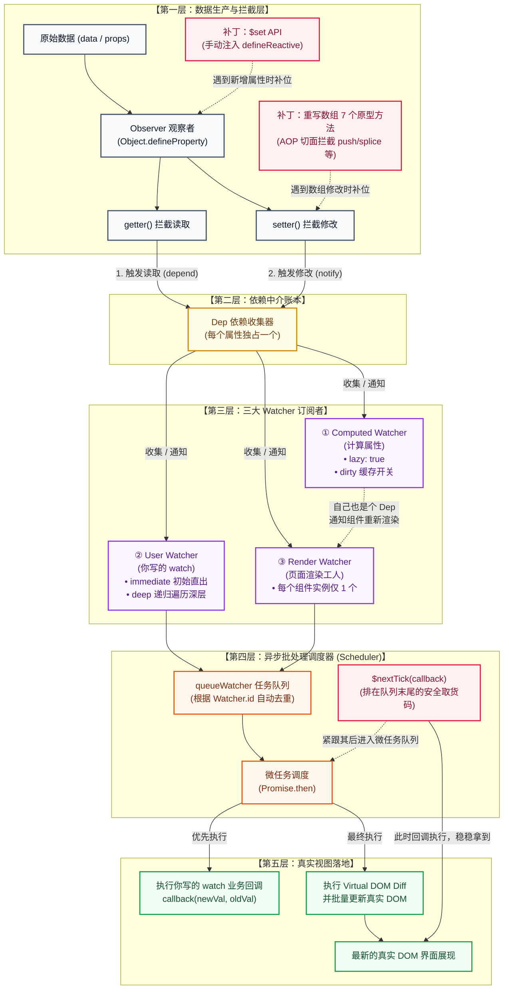

# Vue 响应式系统底层全景架构图（Mermaid 与流程解析）

> **💡 查看方式**：  
> 1. **最省心（免插件直接看彩色大图）**：直接在浏览器中打开生成的 HTML 文件 👉 [00-Vue响应式系统底层全景架构图.html](file:///c:/Users/xzh/Documents/code/VueJSDemo/%E9%9D%A2%E8%AF%95%E9%A2%98/03-%E5%93%8D%E5%BA%94%E5%BC%8F%E5%8E%9F%E7%90%86%E4%B8%8E%E6%A0%B8%E5%BF%83%E6%9C%BA%E5%88%B6/00-Vue%E5%93%8D%E5%BA%94%E5%BC%8F%E7%B3%BB%E7%BB%9F%E5%BA%95%E5%B1%82%E5%85%A8%E6%99%AF%E6%9E%B6%E6%9E%84%E5%9B%BE.html)（双击即看，高清矢量缩放）。
> 2. **在 VS Code 内预览**：VS Code 自带的 Markdown 默认不包含 Mermaid 引擎，在扩展商店搜索安装 **`Markdown Preview Mermaid Support`** 插件即可按 `Ctrl + Shift + V` 实时查看。
> 3. **免插件文本版**：往下滑动直接查看第二部分的【纯文本字符架构图】。

---

## 一、 Mermaid 矢量架构图（支持实时预览与缩放）



---

## 二、 纯文本字符架构图（免插件兼容版）

```text
========================================================================================
【第一层：数据生产与拦截层（源头）】
----------------------------------------------------------------------------------------
   组件中的 data: { count: 0, user: { ... } }
       │
       ▼ （组件初始化时）
   【Observer 观察者】：遍历属性，调用 Object.defineProperty 注入保镖
       ├── getter() ──> [有人读取属性时触发] ──┐
       └── setter() ──> [有人修改属性时触发] ──┼────────┐
                                               │        │
   ┌─────────────────────────────────────────┐ │        │
   │ 🚨 两个补丁机制（弥补 Object.defineProperty 缺陷）： │ │
   │ • $set API  ──────> 动态补上 defineProperty ──┘ │  │
   │ • 数组 7 个原型方法 ─> AOP拦截 push/splice 等 ────────┼───┘
   └─────────────────────────────────────────────────┘  │
                                                        │
========================================================│===============================
【第二层：中介记账层】                                  │
--------------------------------------------------------│-------------------------------
                                                        ▼
                        【 Dep 账本（每个属性独占一个） 】
                           ├── 收集：谁在读我？（把工人登记进花名册）
                           └── 派发：谁改了我？（翻开花名册，挨个叫醒下面的工人）
                                       │
                                       ▼ 叫醒下面三位工人
========================================================================================
【第三层：三大 Watcher 消费层（工种分工）】
----------------------------------------------------------------------------------------
       ┌───────────────────────────────┬───────────────────────────────┐
       ▼                               ▼                               ▼
【① Computed Watcher】         【② User Watcher】             【③ Render Watcher】
     (计算属性)                      (你写的 watch)                 (页面渲染工人)
       │                               │                               │
 • 标记 dirty = true             • 初始读取旧值                  • 每个组件只有 1 个
 • 并不马上计算（惰性求值）        • 携带参数:                     • 负责执行 _render()
 • 自己也是一个 Dep (账本)           - immediate (立即执行)          生成最新虚拟 DOM
   同时顺手叫醒 ③ 渲染工人           - deep (递归遍历子属性)            │
       │                               │                               │
       └───────────────────────────────┼───────────────────────────────┘
                                       ▼ 全部进入排队大厅
========================================================================================
【第四层：异步批处理调度层（Scheduler）】
----------------------------------------------------------------------------------------
                  【 queueWatcher 任务队列（微任务 Promise.then） 】
                     ├── 核心去重：通过 watcher.id 防重复（多次改值只排 1 次队）
                     └── 排序规则：按工号从小到大排队执行
                                       │
       ┌───────────────────────────────┴───────────────────────────────┐
       │                                                               │
       ▼                                                               ▼
  先执行 User Watcher                                            后执行 Render Watcher
  调用你写的业务回调                                                重新执行 Virtual DOM Diff
  callback(newVal, oldVal)                                         把变更一次性刷入真实 DOM！
                                                                       │
                                                                       ▼
=======================================================================│================
【第五层：真实视图落地】                                               │
-----------------------------------------------------------------------│----------------
                                                                【 屏幕显示最新真实 DOM 】
                                                                       ▲
   ┌───────────────────────────────────────────────────────────────────┘
   │ 💡 【 nextTick(callback) 的位置 】
   │ 它也是一个微任务，但排在队列的最末尾！
   │ 只有当上面的真实 DOM 彻底刷完后，nextTick 的回调才开始执行，
   │ 所以在它里面抓 DOM，100% 能拿到最新状态！
   └───────────────────────────────────────────────────────────────────
========================================================================================
```

---

## 三、 各核心机制的“生态位与业务价值”总结

1. **`$set` 与“数组变异方法”**：
   * 属于**【第一层数据源头的补丁】**；
   * 弥补 ES5 `Object.defineProperty` 无法捕获“新增 key”与“数组索引修改”的天然缺陷。
2. **`computed`（计算属性）**：
   * 属于**【第三层的跨层双面人】**；
   * 对下利用 `dirty` 标志位实现惰性求值与缓存（没人读就不计算）；对上自身充当 `Dep`，在变动时唤醒组件的渲染工人。
3. **`watch`（侦听器）**：
   * 属于**【第三层的业务副作用处理者】**；
   * 负责在数据变动时执行开发者编写的异步请求、路由跳转或复杂业务逻辑。
4. **`nextTick`**：
   * 属于**【第四层异步队列末尾的提货凭证】**；
   * 解决 DOM 异步批量渲染导致同步拿 DOM 落空的痛点，确保在微任务清空、真实 DOM 渲染完毕后安全获取新节点信息。
